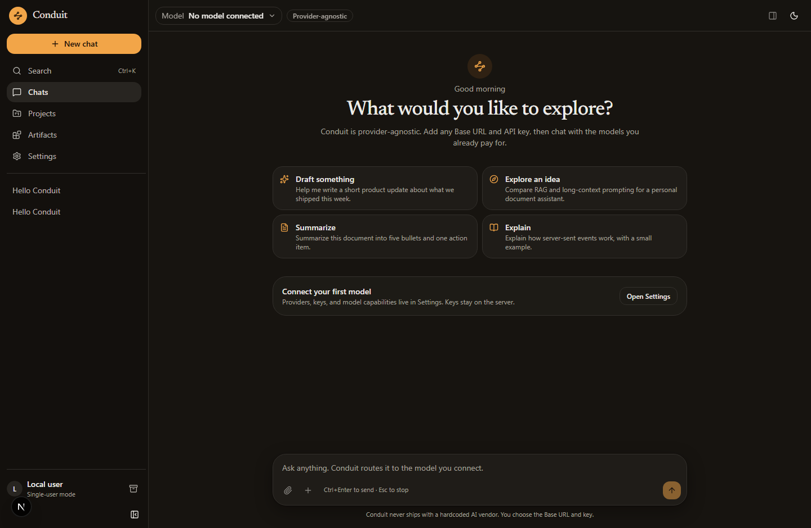
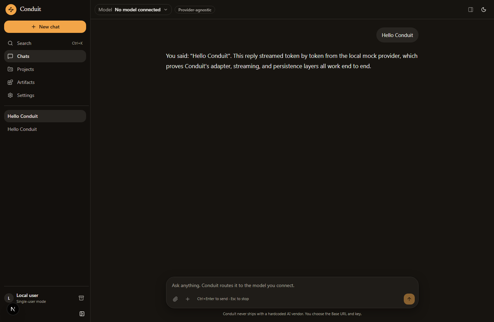
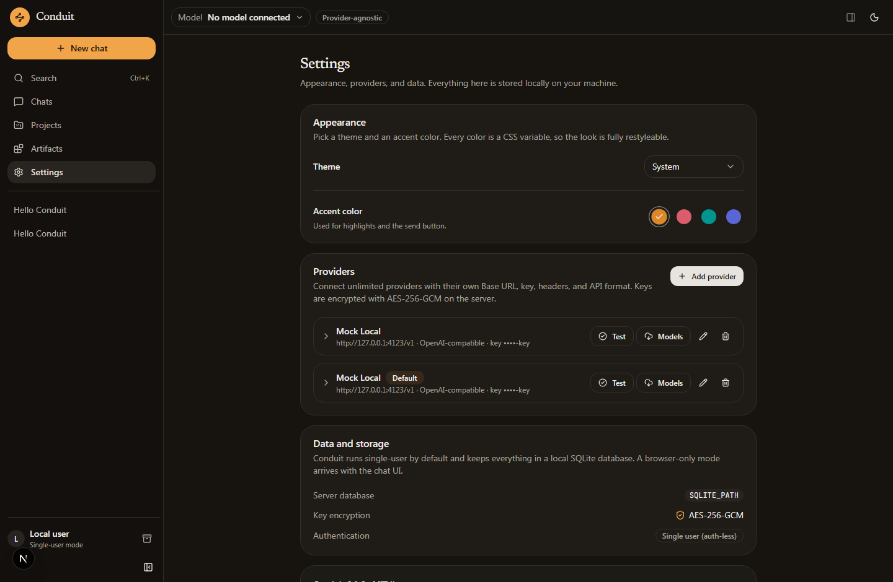
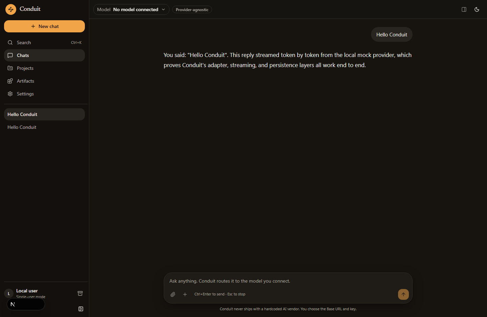

<div align="center">

# Conduit

**A polished, provider-agnostic chat web app. Bring your own model — any Base URL, any API key, any format.**

No hardcoded AI vendor. No telemetry. No vendor lock-in.

</div>



Conduit is an open-source alternative to hosted chat UIs (claude.ai, ChatGPT, and friends) with one
twist: **you** connect the models. Every provider is a name, a Base URL, an API key, and an API
format. Requests go through your own server, so keys never reach the browser.

## Status

| Milestone | Scope | State |
| --- | --- | --- |
| **M1** | Scaffold, design system, layout, theming, DB schema, single-user mode | ✅ Shipped |
| **M2** | Provider settings, OpenAI-compatible + Anthropic adapters, streaming chat, stop/regenerate, persistence | ✅ Shipped |
| **M3** | Rich markdown/code/LaTeX/Mermaid rendering, titles, search, branching, export/import | ✅ Shipped |
| **M4** | Files, vision, document parsing, attachments | ✅ Shipped |
| **M5** | Artifacts panel with sandboxing and versioning | ✅ Shipped |
| **M6** | Tool calling, web search, fetch, calculator, CSV analysis, citations | ✅ Shipped |
| M7 | Thinking display, context meter, cost tracking, fallback + retry | ⏳ Partial (usage + cost tracking, retry/backoff) |
| M8 | Projects, RAG, memory, styles, slash commands | ⏳ Planned |
| M9 | MCP client, custom tools, Deep Research | ⏳ Planned |
| M10 | Voice, accessibility, PWA, shortcuts, mobile polish | ⏳ Planned |
| M11 | Multi-user auth, sharing, usage dashboard, Docker, tests | ⏳ Partial (Docker, single-user mode) |

What works today:

- Add unlimited providers with their own Base URL, key, custom headers, org/project IDs, and API format.
- "Test connection" with plain-language errors for 401, 404, rate limits, and unreachable hosts.
- Auto-discover models from `GET {baseUrl}/models` plus manual per-model settings (context window,
  max output, capability flags, price per million tokens, default/fallback flags).
- Stream a conversation token by token (SSE), with **Stop**, **Regenerate**, usage, and cost per answer.
- Histories persist to SQLite; the sidebar lists, pins, renames, archives, exports, and deletes chats.
- Answers render GitHub-flavoured Markdown with syntax-highlighted code (copy + wrap), KaTeX math,
  and Mermaid diagrams that only load when a diagram is actually present.
- Every turn is a node in a message tree: edit a user message or regenerate an answer and Conduit
  keeps both versions, with an inline "1/2" switcher. Nothing is overwritten.
- `Ctrl`/`Cmd`+`K` searches chat titles and message bodies with highlighted snippets.
- Chats auto-title themselves once the first answer exists, and can be exported or imported as
  Markdown or JSON.
- Attach text and code files, CSV, JSON, PDF, DOCX, XLSX, and images from the composer (picker,
  drag-and-drop, or paste). Text is extracted server-side; images are handed to the model as data
  URLs, so any vision-capable model you connect can read them. OCR for scanned PDFs is planned.
- Models can wrap self-contained output in `<artifact>` tags: Conduit captures each emission as a
  version, shows it in a side panel (HTML/SVG in a sandboxed iframe, Mermaid, Markdown, or code),
  and can diff revisions. A `/artifacts` library lists everything across chats.
- Models can call tools. Enable them per chat from the composer’s wrench menu: **web search**
  (Tavily, Brave, Serper, or a self-hosted SearXNG — configured in Settings → Tools),
  **fetch URL** (SSRF-guarded, text-only, 1 MB cap), a **calculator** that never uses `eval`, and
  **CSV / table analysis**. Calls stream into the transcript as collapsible cards with their
  output and any sources, and the model keeps working until it has an answer.
- Light / dark / system themes and a user-selectable accent color.

## Screenshots

| Conversation | Settings |
| --- | --- |
|  |  |

Dark theme:



## Quick start

Requirements: **Node.js 20.9+** (22+ recommended). No Docker required for local development.

```bash
git clone <your-fork> conduit && cd conduit
npm install
cp .env.example .env

# Generate the key that encrypts provider API keys at rest
node -e "console.log('ENCRYPTION_KEY=' + require('crypto').randomBytes(32).toString('hex'))"
# paste the line into .env

npm run dev
```

Open <http://localhost:3000>, go to **Settings → Providers**, and add your first provider.

### Docker

```bash
cp .env.example .env      # set ENCRYPTION_KEY
docker compose up --build
```

The compose file stores SQLite data in the `conduit-data` volume mounted at `/data`
(set `SQLITE_PATH=/data/conduit.db`, which the compose file already does).

## Connecting a provider

Everything is configured in **Settings → Providers**. Pick the API format that matches the endpoint:

| API format | Status | Endpoint Conduit calls | Examples |
| --- | --- | --- | --- |
| OpenAI-compatible (Chat Completions) | ✅ Supported | `POST {baseUrl}/chat/completions` | OpenAI, Ollama, LM Studio, vLLM, OpenRouter, Groq, Together, Fireworks, LiteLLM |
| Anthropic Messages API | ✅ Supported | `POST {baseUrl}/messages` | Anthropic, Claude-compatible gateways |
| OpenAI Responses API | ⏳ Planned | — | OpenAI Responses-only features |
| Google Gemini | ⏳ Planned | — | Google AI Studio, Vertex |

Base URLs point at the API root, because Conduit appends the paths itself:

| Provider | Base URL | Key |
| --- | --- | --- |
| OpenAI | `https://api.openai.com/v1` | required |
| Anthropic | `https://api.anthropic.com/v1` | required |
| Ollama (local) | `http://localhost:11434/v1` | any value or blank |
| LM Studio (local) | `http://localhost:1234/v1` | any value or blank |
| vLLM | `http://localhost:8000/v1` | optional |
| OpenRouter | `https://openrouter.ai/api/v1` | required |

Then press **Models** to import the model list and **Set default** on the model you want to chat with.
Capability flags (vision, tools, reasoning, JSON mode, prompt caching) hide UI features a model cannot
serve, so the interface never promises more than the model can do.

### Try it without spending tokens

A mock OpenAI-compatible provider ships with the repo:

```bash
npm run mock:provider     # serves http://127.0.0.1:4123/v1 with two fake models
npm run smoke
npm run files:check             # 17 end-to-end checks: provider CRUD, streaming, persistence, regenerate
```

Add a provider pointing at `http://127.0.0.1:4123/v1` (any key) to chat with the mock from the UI.

## Environment variables

| Variable | Required | Purpose |
| --- | --- | --- |
| `ENCRYPTION_KEY` | ✅ for saving keys | Derives the AES-256-GCM key that encrypts provider API keys at rest. Any long random string. |
| `SQLITE_PATH` | — | SQLite file location. Defaults to `./data/conduit.db`. |
| `APP_PASSWORD` | — | Optional single-user password gate (planned, M11). |
| `NEXT_PUBLIC_APP_URL` | — | Public URL used for share links (M11). |

## Architecture

```
Browser (React 19 · Zustand · Tailwind v4 · Radix)
   │  fetch/SSE            ▲ normalized stream events
   ▼                       │
Next.js route handlers (/api/*)   ← the only place that sees API keys
   │  Drizzle ORM
   ▼
SQLite (better-sqlite3)  +  AES-256-GCM key vault
   │  adapter layer
   ▼
Provider APIs (OpenAI-compatible · Anthropic · …)
```

Key ideas:

- **One internal message + event format.** Adapters translate to and from each vendor. The UI only
  knows `text_delta`, `reasoning_delta`, `tool_call_*`, `usage`, `error`, `done`.
- **Keys never leave the server.** They are encrypted before insert, masked in every response, and
  never logged. The browser receives a masked hint (`••••1234`) at most.
- **Streaming is resumable-ish by design.** The assistant row is created before generation starts, so
  a dropped connection still leaves a saved message with whatever tokens arrived.
- **Retries stop before duplicate output.** 429/5xx responses are retried with exponential backoff
  only while no bytes have been forwarded.

More detail: [docs/architecture.md](docs/architecture.md).

## Project structure

```
app/                 App Router pages and /api routes
  api/chat/          SSE streaming endpoint (the chat pipeline)
  api/providers/     Provider CRUD, connection test, model discovery
  api/chats/         Chat + message persistence
components/          UI: layout shell, chat surface, settings, Radix primitives
lib/providers/       Adapter layer (OpenAI-compatible, Anthropic) + SSE + retry helpers
lib/server/          Server-only data access (providers, chats, usage, validation)
lib/db/              Drizzle schema, SQLite client, migrations
lib/store/           Zustand stores (UI state, chat/streaming state)
lib/local/           Dexie (IndexedDB) store for local-only mode
scripts/             Mock provider + end-to-end smoke test
drizzle/             Generated SQL migrations
docs/                Architecture notes and screenshots
```

## Scripts

| Command | What it does |
| --- | --- |
| `npm run dev` | Start the dev server on port 3000. |
| `npm run build` / `npm start` | Production build and serve. |
| `npm run typecheck` | `tsc --noEmit` across the project. |
| `npm run lint` | ESLint (flat config, Next + TypeScript rules). |
| `npm run format` | Prettier. |
| `npm run db:generate` | Generate SQL migrations from `lib/db/schema.ts`. |
| `npm run db:studio` | Browse the database with Drizzle Studio. |
| `npm run mock:provider` | Start the local mock provider on port 4123. |
| `npm run smoke
npm run files:check` | Run the end-to-end API checks against a running app. |

## Security

- Provider API keys are encrypted with **AES-256-GCM** (`ENCRYPTION_KEY`) and are never returned to the
  browser or written to logs.
- All provider traffic happens server-side, which also removes browser CORS problems.
- Ongoing hardening on the roadmap: CSRF tokens for state-changing routes, strict CSP + security
  headers, DOMPurify for rendered HTML, SSRF guards on the fetch tool, upload type/size validation,
  and sandboxed iframes for artifacts.
- Conduit is single-user by default and binds to your machine; optional multi-user auth arrives in M11.

## Contributing

Issues and pull requests are welcome. Before opening a PR:

```bash
npm run typecheck && npm run lint && npm run smoke
npm run files:check    # with dev + mock provider running
```

Keep adapters vendor-neutral: new formats belong in `lib/providers/` behind the existing
`ProviderAdapter` interface, with no vendor-specific code in components.

## License

MIT — see [LICENSE](LICENSE).