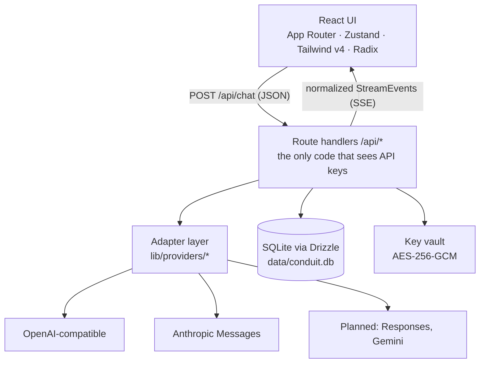

# Conduit architecture

How a message travels from the composer to a provider and back, plus the decisions behind the shape
of the code. Milestone references match the project plan.

## Layers



The rule that keeps the design honest: **vendor knowledge lives only in `lib/providers/`.** Components
never branch on a provider name, and the database never stores vendor payloads.

## Data model

| Table | Purpose | Milestone |
| --- | --- | --- |
| `providers` | Base URL, API format, custom headers, org/project, encrypted key, role flags | M2 |
| `models` | Discovered models + capability flags, context window, pricing, default/fallback | M2 |
| `chats` | Title, system prompt, sampling controls, thinking budget, pin/archive/project links | M2 |
| `messages` | `parent_id` + `branch_index` tree, normalized content parts, usage, cost, error | M2 |
| `artifacts` | Artifact versions keyed by model-supplied identifier | M5 |
| `projects`, `project_files` | Knowledge bases and indexing state | M8 |
| `memories`, `response_styles`, `saved_prompts` | Personalization | M8 |
| `share_links`, `usage_events`, `app_settings` | Sharing, dashboards, key/value settings | M10/M11 |

Messages store normalized `ContentPart[]`: `text`, `image`, `document`, `tool_use`, `tool_result`,
`thinking`. Combined with `parent_id`, that one column supports branching (M3), attachments (M4),
tool loops (M6), and reasoning traces (M7) without schema churn.

## Message tree and branching (M3)

Every message row carries `parent_id` and `branch_index`, and `chats.active_leaf_id` points at the
leaf that defines the visible path. Two operations create branches instead of overwriting history:

- **Edit a user turn** (`POST /api/messages/{id}/edit`) writes a sibling user message and moves the
  active leaf to it; the client then calls `/api/chat` with `continueFromLeaf` to answer it.
- **Regenerate** (`POST /api/chat` with `regenerate: true`) writes a sibling assistant answer under
  the same user turn.

`POST /api/messages/{id}/switch` moves the active leaf to the deepest descendant of a message, or
steps to the previous/next sibling when passed `{ "direction": "prev" | "next" }`. The chat detail
endpoint returns the active path annotated with `siblingIndex`/`siblingCount`, which is all the
version switcher in the UI needs. Nothing is deleted when you branch, so history stays intact.

## Rendering, search, and export (M3)

Assistant text is rendered by a `react-markdown` pipeline: `remark-gfm`, `remark-math` + KaTeX,
`rehype-highlight` for code, `rehype-sanitize` with an extended allow-list, and a lazily imported
Mermaid renderer. Outputs longer than ~2400 characters collapse behind a "Show output" toggle.

Search (`GET /api/search?q=`) matches lower-cased substrings in chat titles and the JSON `content`
column, and returns a snippet around the first hit. Export (`GET /api/chats/{id}/export?format=md|json`)
and import (`POST /api/chats/import`) round-trip a transcript, including attachments and thinking
parts, so a Conduit instance can be migrated by copying JSON.

Titles are generated by `lib/server/title.ts`: it prefers a provider flagged `isTitleModel`, falls
back to the default provider, asks for a title of at most six words, and records `chats.title_source`
as `auto`, `model`, or `user` so a manual rename is never overwritten.

## Attachments (M4)

`POST /api/files` accepts `multipart/form-data`, writes the bytes to `data/uploads/<id>`, records
metadata in the `attachments` table, and returns a normalized payload the client can turn into
`ContentPart`s:

| Input | Extraction | Part sent to the model |
| --- | --- | --- |
| `.txt`, `.md`, code, JSON, XML, YAML | UTF-8, capped at 200k characters | `document` |
| `.csv`, `.xlsx`, `.xls` | SheetJS → cap 12 sheets / 400 rows / 40 columns as Markdown tables | `document` |
| `.pdf` | pdfjs-dist text layer (loaded through `createRequire` so bundlers leave its worker alone) | `document` |
| `.docx` | mammoth raw text | `document` |
| `.png`, `.jpeg`, `.webp`, `.gif` | passthrough (≤ 8 MB) | `image` with a data URL |

Everything else is rejected with a 415 and a plain-language explanation. Legacy `.doc`, scanned-document
OCR, and office-format conversion are explicitly **not** implemented yet.

`GET /api/files/{id}` streams the stored bytes back with the original content type, which is what the
image previews in the transcript use. Attachments are capped at 25 MB and the bytes live outside the
repository (`data/uploads/`, git-ignored) — only metadata and extracted text go into SQLite.

## Provider contract

```ts
interface ProviderAdapter {
  stream(request: StreamRequest): AsyncGenerator<StreamEvent, void, unknown>;
  listModels(connection: ProviderConnection): Promise<ModelInfo[]>;
}
```

`StreamEvent` is the whole vocabulary the rest of the app understands:

| Event | Meaning |
| --- | --- |
| `text_delta` | New assistant text |
| `reasoning_delta` | Extended-thinking text (rendered in a collapsible panel) |
| `tool_call_start` / `tool_call_delta` / `tool_call_end` | Tool invocation lifecycle |
| `usage` | Token counts for metering and cost |
| `error` | Provider failure with a human-readable message |
| `done` | Terminal event, always sent |

Adding a vendor = one file in `lib/providers/`, one entry in the registry, one row in the settings
dropdown. Unsupported formats throw a `501` with an explanatory message instead of failing silently.

## Streaming lifecycle (`POST /api/chat`)

1. Validate the body (Zod) and resolve the chat, model, and provider.
2. Persist the incoming user turn (or delete the previous assistant turn when `regenerate: true`).
3. Insert an **empty** assistant row immediately, so a dropped connection still leaves a saved message.
4. Stream `StreamEvent`s to the browser as SSE, accumulating text, reasoning, tool calls, and usage.
5. On completion or abort, update the assistant row (content, usage, cost, error) and write a
   `usage_events` row; if the request aborted, keep whatever text arrived.
6. `Stop` in the UI cancels the upstream request through an `AbortController` wired to
   `request.signal`, so the provider stops generating too.

Retries (429/5xx, exponential backoff, `Retry-After` respected) happen **before** the first byte is
forwarded. Once tokens are flowing, a retry would duplicate output, so errors are surfaced instead.

## Security model

- **Key handling.** `lib/crypto.ts` derives an AES-256-GCM key from `ENCRYPTION_KEY`, encrypts each API
  key, and stores the ciphertext plus its IV. `maskSecret` is the only way a key ever appears in a
  response. Nothing logs a key or an `Authorization` header.
- **Server-side provider traffic.** Keys are used only in route handlers, which also removes browser
  CORS problems and lets Conduit pin timeouts and retries.
- **Single-user by default.** No auth means no session to steal, and the app is meant to run on your
  machine or behind your own reverse proxy. Multi-user mode (M11) adds NextAuth, per-user providers,
  and rate limits.
- **Known gaps before M11.** CSRF protection for state-changing routes, strict CSP/security headers,
  DOMPurify on rendered HTML, SSRF guards for the fetch tool, upload validation, and sandboxed
  artifact iframes are planned rather than implemented; treat the current build as local-first.

## Decisions and trade-offs

- **SQLite + Drizzle, not Postgres.** A personal chat client should be one file you can copy. Vector
  search (M8) will use `sqlite-vec` when available, with BM25/full-context fallback.
- **Dexie mirror for local-only mode.** The browser store mirrors the same entities so a future sync
  layer is mechanical; today the server database is the source of truth.
- **SSE, not WebSockets.** Provider APIs are HTTP streams; SSE keeps every hop a plain HTTP response
  that proxies and Docker handle well, with `AbortController` for cancellation.
- **No vendor SDKs.** Hand-rolled adapters against raw HTTP keep the dependency tree small and make
  the normalization layer explicit — which is the entire point of the project.