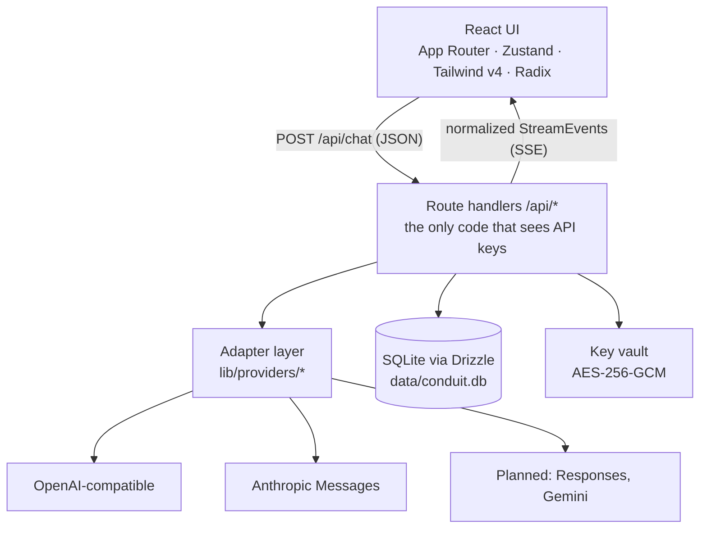

# Conduit architecture

How a message travels from the composer to a provider and back, plus the decisions behind the shape
of the code. Milestone references match the project plan.

## Layers



The rule that keeps the design honest: **vendor knowledge lives only in `lib/providers/`.** Components
never branch on a provider name, and the database never stores vendor payloads.

## Data model

| Table | Purpose | Milestone |
| --- | --- | --- |
| `providers` | Base URL, API format, custom headers, org/project, encrypted key, role flags | M2 |
| `models` | Discovered models + capability flags, context window, pricing, default/fallback | M2 |
| `chats` | Title, system prompt, sampling controls, thinking budget, pin/archive/project links | M2 |
| `messages` | `parent_id` + `branch_index` tree, normalized content parts, usage, cost, error | M2 |
| `artifacts` | Artifact versions keyed by model-supplied identifier | M5 |
| `projects`, `project_files` | Knowledge bases and indexing state | M8 |
| `memories`, `response_styles`, `saved_prompts` | Personalization | M8 |
| `share_links`, `usage_events`, `app_settings` | Sharing, dashboards, key/value settings | M10/M11 |

Messages store normalized `ContentPart[]`: `text`, `image`, `document`, `tool_use`, `tool_result`,
`thinking`. Combined with `parent_id`, that one column supports branching (M3), attachments (M4),
tool loops (M6), and reasoning traces (M7) without schema churn.

## Provider contract

```ts
interface ProviderAdapter {
  stream(request: StreamRequest): AsyncGenerator<StreamEvent, void, unknown>;
  listModels(connection: ProviderConnection): Promise<ModelInfo[]>;
}
```

`StreamEvent` is the whole vocabulary the rest of the app understands:

| Event | Meaning |
| --- | --- |
| `text_delta` | New assistant text |
| `reasoning_delta` | Extended-thinking text (rendered in a collapsible panel) |
| `tool_call_start` / `tool_call_delta` / `tool_call_end` | Tool invocation lifecycle |
| `usage` | Token counts for metering and cost |
| `error` | Provider failure with a human-readable message |
| `done` | Terminal event, always sent |

Adding a vendor = one file in `lib/providers/`, one entry in the registry, one row in the settings
dropdown. Unsupported formats throw a `501` with an explanatory message instead of failing silently.

## Streaming lifecycle (`POST /api/chat`)

1. Validate the body (Zod) and resolve the chat, model, and provider.
2. Persist the incoming user turn (or delete the previous assistant turn when `regenerate: true`).
3. Insert an **empty** assistant row immediately, so a dropped connection still leaves a saved message.
4. Stream `StreamEvent`s to the browser as SSE, accumulating text, reasoning, tool calls, and usage.
5. On completion or abort, update the assistant row (content, usage, cost, error) and write a
   `usage_events` row; if the request aborted, keep whatever text arrived.
6. `Stop` in the UI cancels the upstream request through an `AbortController` wired to
   `request.signal`, so the provider stops generating too.

Retries (429/5xx, exponential backoff, `Retry-After` respected) happen **before** the first byte is
forwarded. Once tokens are flowing, a retry would duplicate output, so errors are surfaced instead.

## Security model

- **Key handling.** `lib/crypto.ts` derives an AES-256-GCM key from `ENCRYPTION_KEY`, encrypts each API
  key, and stores the ciphertext plus its IV. `maskSecret` is the only way a key ever appears in a
  response. Nothing logs a key or an `Authorization` header.
- **Server-side provider traffic.** Keys are used only in route handlers, which also removes browser
  CORS problems and lets Conduit pin timeouts and retries.
- **Single-user by default.** No auth means no session to steal, and the app is meant to run on your
  machine or behind your own reverse proxy. Multi-user mode (M11) adds NextAuth, per-user providers,
  and rate limits.
- **Known gaps before M11.** CSRF protection for state-changing routes, strict CSP/security headers,
  DOMPurify on rendered HTML, SSRF guards for the fetch tool, upload validation, and sandboxed
  artifact iframes are planned rather than implemented; treat the current build as local-first.

## Decisions and trade-offs

- **SQLite + Drizzle, not Postgres.** A personal chat client should be one file you can copy. Vector
  search (M8) will use `sqlite-vec` when available, with BM25/full-context fallback.
- **Dexie mirror for local-only mode.** The browser store mirrors the same entities so a future sync
  layer is mechanical; today the server database is the source of truth.
- **SSE, not WebSockets.** Provider APIs are HTTP streams; SSE keeps every hop a plain HTTP response
  that proxies and Docker handle well, with `AbortController` for cancellation.
- **No vendor SDKs.** Hand-rolled adapters against raw HTTP keep the dependency tree small and make
  the normalization layer explicit — which is the entire point of the project.